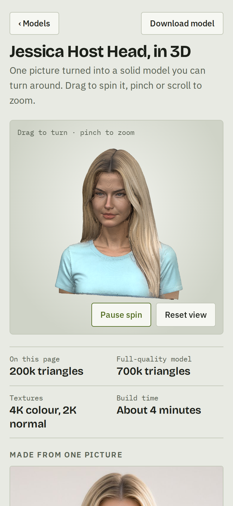

# 3D Models: one picture to a model you can spin

A small phone-first page that turns one to three reference pictures of a character, creature or object
into a textured 3D model (GLB), plus a light copy and a spin page you can open on a phone.

## How it works

1. **Clean picture.** Qwen-Image 2.1 redraws the subject from your reference pictures: whole subject in
   frame, plain background, even light. The wording is fixed per kind (`prompts.json`) and never describes
   the subject; the reference pictures do that.
2. **3D build.** An image-to-3D graph in ComfyUI (Pixal3D with TRELLIS.2, from the stock template
   `3d_pixal3d_trellis2_image_to_model`, frozen in `graph.json`) cuts out the subject, estimates its shape,
   builds a mesh of about 700,000 triangles, then bakes colour, normal and shading maps. Seeds are fixed,
   so the same picture gives the same model.
3. **Phone copy.** `repack_glb.py` and `split_gltf.py` make a 200,000-triangle copy with 2K textures
   (glTF JSON plus JPEG), and `page.template.html` shows it with three.js.

A build takes about 4 to 12 minutes on a capable graphics card.

## Using the page

Start it with `./run.sh` and open http://127.0.0.1:8258/.

1. Tap **+**. Type a **Name**, pick **What it shows** (Person, Head, or Creature or object), tap
   **Add pictures** and choose 1 to 3 reference pictures. Tap **Create**.
2. Tap **Make picture** (about a minute).
3. Check it. **Redo picture** makes another try; **...** then **Use my picture as is** skips the step.
4. Tap **Build 3D model**, then **Start build**. The page shows the step it is on.
5. Drag to turn, pinch to zoom. **Download model** saves the full GLB.

## Results and limits

- A creature (our Earth Dragon) came out good from every side.
- A face from a full-body picture comes out poor (smeared eyes). For a face, pick **Head**: it reads well
  at normal spin distance, though zoomed right in the eyes are milky and the skin shows faint ripples.
- The model is frozen in the pose of the picture, anything the picture does not show (the back) is a
  guess, and it has no skeleton, so it cannot be reposed.

## Fitting it to your setup

This was written for one home setup, so `model3d.py` expects:

- an image API that serves Qwen-Image 2.1 jobs (`STUDIO`, `/generate/async`, `/jobs/<id>`);
- a ComfyUI instance with the Pixal3D and TRELLIS.2 nodes and their weights (`SANDBOX`), run as a
  Docker container named `sandbox` that the kit starts and stops;
- a GPU lease tool it calls before a build (`LOCK`). Remove the lease calls if you run one job at a time.

Change those constants at the top of `model3d.py`. The page (`server.py`, `ui.html`) holds no build
logic; every button runs a `model3d.py` command.

Built models land in `models/<slug>/`, which is not tracked.
